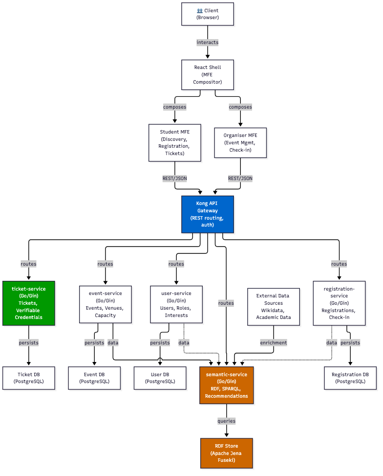
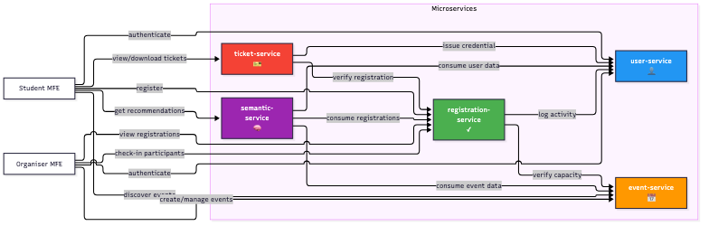
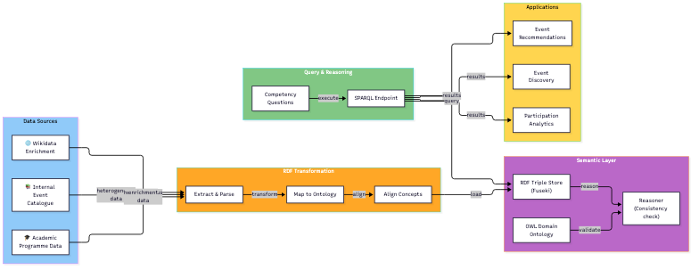
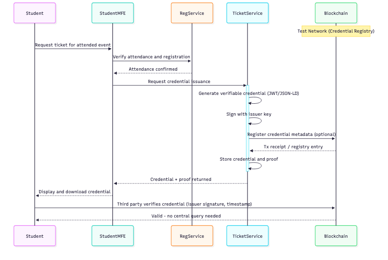
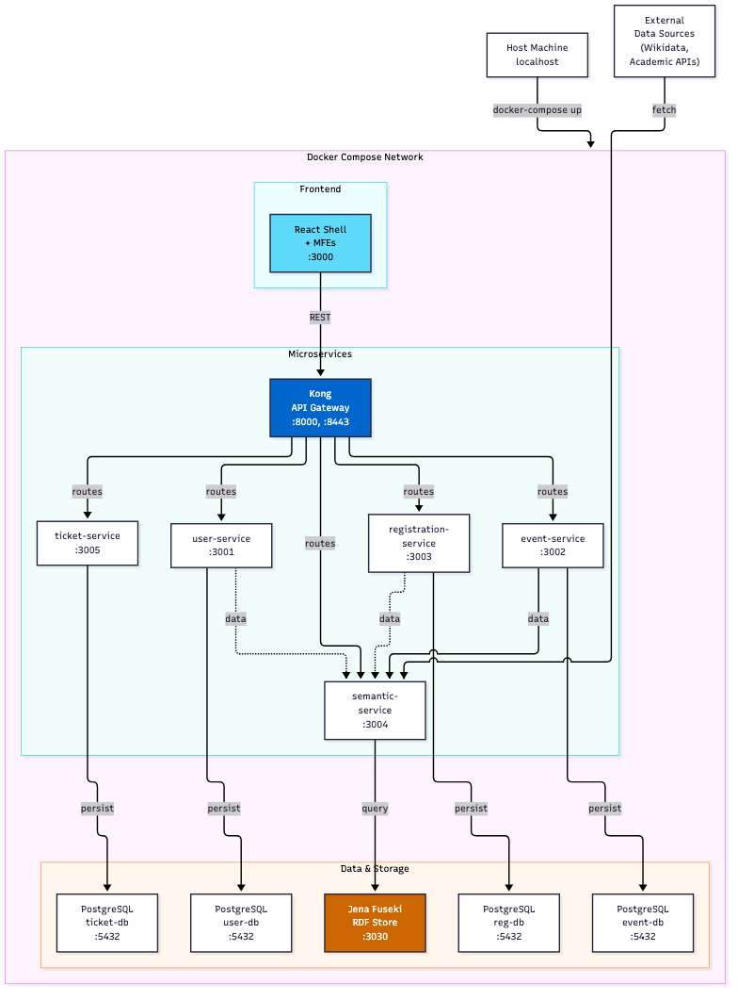

# Campus Pulse — Architecture Diagrams

This folder contains the architecture diagrams for **Campus Pulse**, a student
event management system developed for the Semantic Web and Web 3.0 course unit
(Universidade Fernando Pessoa, 2026/2027). The authoritative project brief is in
[project_instructions/project_protocol.md](../project_instructions/project_protocol.md).

Each diagram is provided as Mermaid source (`.mmd`) and a rendered PNG.

To re-render the PNGs after editing a `.mmd` file:

```bash
npx -y @mermaid-js/mermaid-cli -i <name>.mmd -o <name>.png
```

---

## 1. Overall System Architecture



### Components

- **Kong API Gateway** (Kong, containerised) — single entry point for all client
  traffic; routing, authentication and rate limiting. Serves the *cross-cutting
  infrastructure* domain: it owns no business data.
- **React Shell + Micro Frontends** (React) — the composed user interface:
  - **student-mfe** — event discovery, registration, tickets/credentials.
  - **organiser-mfe** — event creation and management, registrations, check-in.
- **Five Go/Gin microservices** (Go + Gin, REST/JSON):
  - **user-service** — users, roles (student/organiser), interests. Domain: identity.
  - **event-service** — events, dates, locations, capacities. Domain: event catalogue.
  - **registration-service** — registrations, available places, check-in. Domain: participation.
  - **semantic-service** — integrates heterogeneous sources into RDF, serves the
    OWL ontology and SPARQL for event recommendations. Domain: knowledge/recommendation.
  - **ticket-service** — issues and verifies digital tickets via verifiable
    credentials (Web 3.0 component). Domain: credentials.
- **Data layer** — one PostgreSQL database per service (microservice-per-database
  pattern), plus an Apache Jena Fuseki triple store for the semantic layer, and
  external sources (Wikidata, academic data) feeding the semantic-service.

### Data flow

1. The browser loads the React shell, which composes the appropriate MFE.
2. MFEs call the backend exclusively through Kong (REST/JSON).
3. Kong routes to the owning microservice; each service persists to its own database.
4. Event, user and registration data flow into the semantic-service, which
   transforms them to RDF and exposes them through SPARQL.

---

## 2. Service Interactions



- **student-mfe** authenticates with user-service, discovers events via
  event-service, registers through registration-service, gets recommendations
  from semantic-service, and manages tickets via ticket-service.
- **organiser-mfe** creates and manages events in event-service and handles
  registrations/check-ins through registration-service.
- **registration-service** verifies capacity with event-service before
  confirming a registration.
- **ticket-service** checks registration/attendance with registration-service
  before issuing a credential.
- **semantic-service** consumes event, user and registration data to compute
  recommendations and answer domain questions.

Communication is synchronous REST for the request paths shown; asynchronous
messaging (a valued extra in the protocol) may be added for data propagation
into the semantic layer.

---

## 3. Semantic Layer & Data Integration



End-to-end pipeline (requirements R6–R8):

1. **Data sources** — the internal event catalogue, academic programme/course-unit
   data, and Wikidata for enrichment (institutions, locations, competences).
2. **RDF transformation** — extract from each source, map concepts to the domain
   ontology, align external entities with internal ones.
3. **Semantic layer** — the OWL ontology (modelled in Protégé) defines classes,
   properties and restrictions; the triple store (Fuseki) holds the transformed
   data; a reasoner validates consistency.
4. **Query** — a SPARQL endpoint answers the domain's competency questions
   (at least five queries per R8).
5. **Applications** — event recommendations, semantically filtered discovery,
   and participation analytics.

The value of the layer comes from combining sources that describe the same
entities differently: the internal catalogue knows the events, academic data
links them to programmes and learning outcomes, and Wikidata provides canonical
identifiers for shared concepts.

---

## 4. Web 3.0 — Ticket & Verifiable Credential Flow



1. A student requests a ticket for an event they attended.
2. registration-service confirms registration and attendance.
3. ticket-service generates a **verifiable credential** (JWT or JSON-LD), signs
   it with the issuer key, optionally registers its metadata on a test network,
   and returns it to the student.
4. Any third party (e.g. an employer) can verify the credential by checking the
   issuer's signature — **without contacting the university**.

Relevance (R9): participation records become portable and independently
verifiable. The justification to defend in the documentation is honest: the
value is in decentralised verification, not in replacing the internal systems.

---

## 5. Container & Orchestration View



- Every component runs as a container in a single Docker Compose network:
  Kong, the five Go services, the React shell + MFEs, four PostgreSQL instances
  (one per service) and the Jena Fuseki RDF store.
- Kong exposes :8000/:8443 to the host; individual services are only reachable
  inside the network. Fuseki listens on :3030.
- Databases persist through Docker volumes.
- Service discovery uses container names on the Compose bridge network.
- The semantic-service fetches external sources (Wikidata, academic APIs) from
  outside the stack.

The whole solution starts from a clean environment with one command (R3):

```bash
docker-compose up -d
```

---

## How It All Works Together

**Scenario: a student discovers an event, attends it, and receives a credential.**

1. **Discovery** — the student opens the app; the React shell loads and
   authenticates them through Kong against user-service.
2. **Recommendations** — the student-mfe shows the event catalogue from
   event-service, enriched with recommendations computed by semantic-service:
   SPARQL queries over the RDF graph rank events by match with the student's
   interests (drawn from user-service) and their programme's competences
   (drawn from the academic data source).
3. **Registration** — the student registers; registration-service verifies
   remaining capacity with event-service and persists the registration.
4. **Semantic enrichment** — in the background, the semantic-service keeps its
   RDF graph in sync with the catalogue, academic data and Wikidata, refining
   future recommendations.
5. **Check-in** — at the venue, an organiser checks the student in via
   organiser-mfe → registration-service.
6. **Credential** — after the event, the student requests their ticket;
   ticket-service verifies attendance and issues a signed verifiable credential.
7. **Verification** — anyone the student shares the credential with can verify
   it cryptographically, without querying the university.

That single journey exercises every layer: the micro-frontend composition (R5),
the gateway and microservices (R1–R3), the semantic layer (R6–R8) and the
Web 3.0 component (R9).

---

## Technology Summary

| Layer | Technology | Domain |
|-------|-----------|--------|
| API Gateway | Kong (DB-less, containerised) | Entry point, cross-cutting |
| Microservices | Go + Gin, REST/JSON | Identity, events, participation, recommendations, credentials |
| Databases | PostgreSQL (one per service) | Service-owned persistence |
| Semantic layer | OWL (Protégé), RDF, Jena Fuseki, SPARQL | Knowledge integration & recommendations |
| Frontend | React (shell + 2 MFEs) | Student & organiser interfaces |
| Web 3.0 | Verifiable credentials (JWT/JSON-LD), optional test-network registry | Decentralised ticket verification |
| Orchestration | Docker + Docker Compose | Reproducible local deployment |
