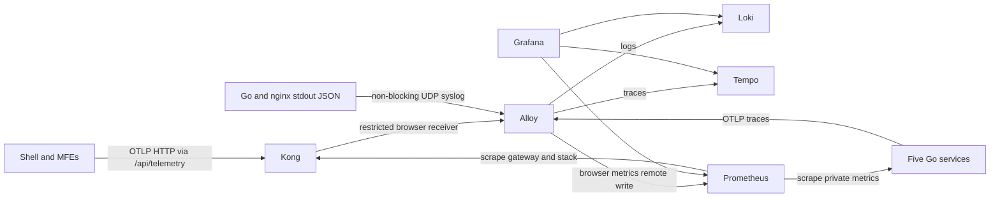

# Observability

Campus Pulse uses structured JSON logs, OpenTelemetry traces, and Prometheus
metrics across all five Go services, Kong, the shell, and both MFEs. This supports
R4 without changing the course protocol's application or persistence architecture.

## Start

Set a private `GRAFANA_ADMIN_PASSWORD` in the root `.env` (generate a value with
`openssl rand -hex 24`), then run from the repository root:

```sh
docker compose --profile backend up --build
```

Grafana: <http://localhost:3001>, username `admin` unless overridden by
`GRAFANA_ADMIN_USER`. Prometheus: <http://localhost:9090>. These ports bind to
loopback; neither should be exposed publicly. Loki, Tempo, Alloy, and service
metrics ports are internal. Use `GRAFANA_PORT`, `PROMETHEUS_PORT`, and
`SYSLOG_PORT` to avoid local conflicts.

Grafana saves its users and password hash in its named volume. Changing the
bootstrap password environment variable does not reset an existing account.
Use Grafana's password-reset procedure; do not delete data just to reset access.

## Signal Paths



- Go services expose `/metrics` on internal port **9090**, separately from their
  application listener. Requests, errors, latency histograms, active requests,
  Go/process metrics, and PostgreSQL pool gauges are exported.
- Domain counters use a fixed operation/outcome vocabulary. Outcomes represent
  HTTP success/rejection/failure, not business decisions embedded in HTTP 200
  responses. In particular, a rejected credential check can still be HTTP-successful.
- Server spans, outgoing HTTP spans (including Fuseki), request logs, handler logs,
  and asynchronous ingestion/issuance calls preserve W3C trace context.
- The shell initializes browser telemetry once. Standalone MFEs initialize it
  themselves; a versioned `globalThis` slot prevents duplicate providers across
  independently loaded federation bundles. Navigation, API latency, exceptions,
  network errors, LCP, INP, and CLS are attributed by MFE and normalized route.
- Browser exporters batch every five seconds (metrics every 15 seconds), use
  bounded queues and three-second timeouts, and attempt a flush on page hide.
  Closing a tab abruptly can lose telemetry; delivery is best effort.

## Configuration

| Setting | Meaning |
| --- | --- |
| `APP_ENV` | Service environment identity; local Compose defaults to `local` |
| `APP_VERSION` | Service and browser release identity; local default `dev` |
| `LOG_LEVEL` | `DEBUG`, `INFO`, `WARN`, or `ERROR` |
| `OTEL_EXPORTER_OTLP_ENDPOINT` | Go OTLP/HTTP base URL; Compose injects `http://alloy:4318` |
| `OTEL_TRACES_SAMPLER_ARG` | Root trace sampling ratio between 0 and 1; default 1 locally |
| `VITE_TELEMETRY_ENABLED` | Explicit browser enablement; true in Compose, disabled by default outside Compose |

Browser settings are build-time values. Rebuild frontend images after changing
them. To use local Vite with telemetry, set `VITE_TELEMETRY_ENABLED=true`,
`VITE_USE_MSW=false`, and the gateway URL while running the backend stack.
Tracing without an exporter endpoint still preserves context; metrics and JSON
logging continue to work. A collector outage must not prevent application work.

## Dashboards as Code

Five dashboards are provisioned in the **Campus Pulse** folder: Overview,
Services, Frontend, Domain Operations, and Telemetry Health. Prometheus, Loki,
and Tempo have stable UIDs. Exemplars link request metrics to traces; JSON log
trace IDs link to Tempo, and Tempo provides a trace-to-logs query.

Edit `dashboards.mjs`, then regenerate and test:

```sh
node observability/dashboards.mjs
node --test observability/dashboards.test.mjs
```

Commit both the source and generated JSON. Provisioned dashboards and datasources
are read-only; UI changes are not the source of truth. UIDs must remain stable
when evolving panels. Grafana reloads dashboard files every 30 seconds; restart
Grafana after changing datasource provisioning. Restart Alloy/Prometheus after
changing their mounted configuration files.

Prometheus records per-service request rates and evaluates service-down and
high-error-rate alerts. They appear in Prometheus; **notification delivery is not
configured**. Add Alertmanager/contact-point routing separately when a destination
and operational owner exist. Thresholds are starter diagnostics, not agreed SLOs.

## Verification

The Observability workflow validates configurations, generated dashboards, alert
fixtures, coverage, ingestion, privacy, and a real multi-service registration trace.
The Go telemetry package has an 80% statement coverage gate; browser telemetry
has 80% line, statement, branch, and function gates.

```sh
node --test observability/dashboards.test.mjs
docker run --rm --entrypoint promtool -v "$PWD/observability:/etc/prometheus:ro" prom/prometheus:v3.5.0 check config /etc/prometheus/prometheus.yml
docker run --rm --entrypoint promtool -w /etc/prometheus/rules -v "$PWD/observability:/etc/prometheus:ro" prom/prometheus:v3.5.0 test rules services.test.yml
docker run --rm -v "$PWD/observability:/etc/alloy:ro" grafana/alloy:v1.11.0 validate /etc/alloy/alloy.alloy
```

With the full stack running and `GRAFANA_ADMIN_PASSWORD` exported in your shell:

```sh
node --test observability/smoke.test.mjs
SMOKE_WRITE_TESTS=true node --test observability/smoke.test.mjs
```

The second command creates a future event and registration using local demo
accounts. Use it only in disposable environments; the fixture remains in the
database. The default tests do not create domain data. Override
`SMOKE_GATEWAY_URL`, `SMOKE_GRAFANA_URL`, and `SMOKE_PROMETHEUS_URL` for other ports.

## Safety and Limits

- Never export bearer tokens, cookies, request/response bodies, query strings,
  personal identities, raw errors, SQL text, or signed credentials. The Go logger
  records error **types** alongside static operation messages instead of raw error
  values. Traces intentionally omit full URLs. Nginx access logs omit URLs too.
- Normalize routes before labeling. User IDs, event IDs, booking references, and
  trace IDs are never metric or Loki stream labels. Trace IDs remain log fields
  or structured metadata. Route-based metrics describe requests, not users.
- Browser ingestion has a separate Alloy receiver, an enforced browser service
  identity, explicit development CORS origins, 256 KiB payload limits, and local
  Kong rate limits (10 requests/second, 120/minute/IP). CORS is **not authentication**;
  this endpoint remains an untrusted, local-only telemetry boundary.
- Alloy strips non-allowlisted span/datapoint/log attributes before forwarding.
  Export queues, container memory, and collector memory are bounded. Root sampling
  can be reduced, but incoming sampled parents retain their sampling decision.
- Docker forwards JSON stdout logs using non-blocking UDP syslog to a loopback
  listener. No Docker socket or host filesystem is mounted into Alloy. Short
  container IDs are required for valid RFC5424 message IDs. UDP logs can be lost
  during bursts, startup, or collector outages; these are not audit-grade logs.
- Prometheus retains up to seven days or 1 GB; Loki and Tempo retain 72 hours.
  All stores use named volumes. Monitor disk usage: time retention does not impose
  a hard byte limit on Loki/Tempo volumes, and compaction/deletion is asynchronous.
- PostgreSQL/Fuseki server internals and database query text are not instrumented.
  Fuseki HTTP calls and PostgreSQL pool utilization are covered without exposing
  semantic queries or SQL parameters.

## Troubleshooting and Production Boundary

Start with `up{job="campus-services"}` in Prometheus. For missing spans, inspect
Alloy/Tempo status and exporter failure counters. For missing logs, inspect Alloy's
`loki_source_syslog_parsing_errors_total` and verify the Docker syslog port and tag.
In Grafana, select an active time range; rates require multiple samples and Web
Vitals are emitted only when the browser observes the corresponding lifecycle.

This stack is local infrastructure, not an AWS rollout. Existing Fargate awslogs
configuration is unchanged. Production requires durable storage, private collector
networking, TLS/authenticated ingestion, telemetry abuse controls, Grafana access
control, backups, alert delivery, and a Fargate-compatible log adapter. Do not copy
the Docker syslog driver settings into ECS or run Terraform apply for this change.

## AI Contribution Record

GitHub Copilot generated the shared Go/browser telemetry packages, integration
changes, collector/storage configuration, dashboard generator and JSON, alert
fixtures, CI workflow, tests, and this runbook. Verification included race-enabled
Go tests, browser coverage gates, frontend lint/typechecks/builds, pinned-binary
configuration validation, live Compose ingestion/correlation tests, and browser
checks of federation-loaded telemetry. Existing date-sensitive ticket tests are
tracked separately in the PR verification notes; no application behavior was
changed to work around an expired fixture.